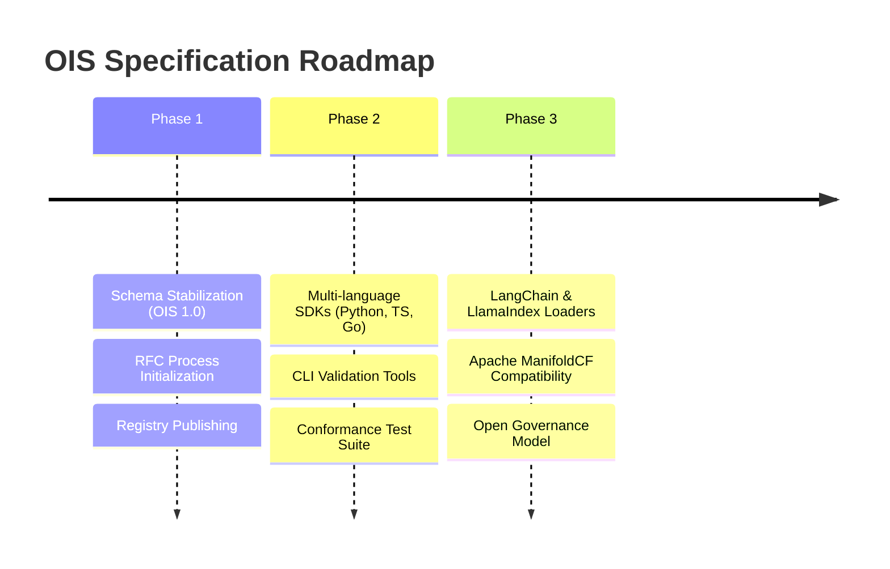

<!--
Copyright © 2026 the original author or authors (piergiorgio@apache.org)

Licensed under the Apache License, Version 2.0 (the "License");
you may not use this file except in compliance with the License.
You may obtain a copy of the License at

    http://www.apache.org/licenses/LICENSE-2.0

Unless required by applicable law or agreed to in writing, software
distributed under the License is distributed on an "AS IS" BASIS,
WITHOUT WARRANTIES OR CONDITIONS OF ANY KIND, either express or implied.
See the License for the specific language governing permissions and
limitations under the License.
-->

# Open Ingestion Standard (OIS) Roadmap 🗺️

This document outlines the strategic phases, releases, and milestones planned for the development and adoption of the **Open Ingestion Standard (OIS)**. 

Our ultimate goal is to establish a secure, vendor-neutral, and decoupled specification for enterprise data routing into modern vector databases and AI architectures.

---

## 📅 Roadmap Overview

---

## 🛠️ Phase 1: Specification Stabilization & Schema 1.0.0 (Short-Term)
**Focus:** Finalize current schemas, validate core zero-trust security assumptions, and formalize the extension model.

- [x] **Release OIS 1.0.0-RC1 (Release Candidate)**
  - Finalize core validation constraints in [document.schema.json](schemas/document.schema.json) and [job.schema.json](schemas/job.schema.json), establishing standard extensions for CMIS repositories, BPMN 2.0 workflow engines (including real-time `bpmn:transitionEvent` notifications), pre-embedding governance (`ois:governance`), and delegated multi-agent provenance (`ois:provenance`).
  - Standardize the Claim Check lifecycle (`claimCheckUri`), cryptographic binary integrity (`sha256`), and the persistent `<key>.ois.json` Cloud/Lakehouse Sidecar format (`sidecarUri`).
  - Formalize normative `FAIL_CLOSED` security evaluation semantics and Relationship-Based Access Control (`relationships` / ReBAC) tuple mappings.
- [ ] **Initiate RFC (Request for Comments) Workflows**
  - Establish a formal RFC template and process for spec amendments.
  - Publish **RFC-001 (Security Identity & ReBAC Mapping)**: Discuss representation standards for Active Directory nested groups, OAuth 2.0 RFC 8693 delegated agent identities (`onBehalfOf` / `actorAgent`), and Zanzibar/OpenFGA relationship tuples.
- [ ] **Public Schema Registries**
  - Host versioned JSON schema files at static, accessible endpoints for automated IDE/CI integrations.
  - Set up automated schema testing using standard validator libraries in GitHub workflows.

---

## ⚙️ Phase 2: Tooling, SDKs & Conformance Testing (Medium-Term)
**Focus:** Make it easy to adopt OIS by providing ready-to-use client libraries, validation tools, and tests.

- [ ] **`ois-validator` CLI**
  - Develop a lightweight, cross-platform CLI tool to quickly validate streaming document payloads, `<key>.ois.json` sidecar files, and job configuration files against OIS schemas.
- [ ] **Standard SDK Libraries**
  - **OIS Python SDK**: Target AI/ML developers creating RAG and Agentic Ingestion pipelines with packages for payload validation, governance redaction envelopes, and metadata formatting.
  - **OIS TypeScript SDK**: Support Node.js/web-based backend and MCP agent workflows.
  - **OIS Go SDK**: Target high-performance systems and cloud migration connector agents.
- [ ] **Conformance Test Suite**
  - Establish a standard set of mock payloads, Fail-Closed ACL & ReBAC variations, `.ois.json` sidecar integrity checks, and configuration files to certify that third-party connectors and runtimes are OIS-compliant.

---

## 🌐 Phase 3: Integration, Compatibility & Governance (Long-Term)
**Focus:** Drive wide-scale industry adoption, integrate with existing systems, and establish vendor-neutral standardization under OASIS Open.

- [ ] **Framework & Agentic Core Integrations**
  - Build community-supported loaders and Model Context Protocol (MCP) tools for AI orchestrators like **Spring AI**, **LlamaIndex**, **LangChain**, and **Haystack** to natively process OIS payloads and query `<key>.ois.json` lakehouse sidecars under Zero-Trust ACL filtering.
- [ ] **Connector & Cloud Migration Bridging**
  - Partner with open-source ingestion platforms (such as Apache ManifoldCF) and distributed object stores (such as Apache Ozone) to support zero-loss ECM-to-Lakehouse migrations and standardized OIS job configurations.
- [ ] **OASIS Open Standardization**
  - Form the **OASIS Open Ingestion Standard (OIS) Technical Committee** with representatives from enterprise content management, cloud storage, connector vendors, and AI/vector database developers (see [OASIS-PROPOSAL.md](OASIS-PROPOSAL.md)).
  - Advance OIS to a ratified OASIS Standard, collaborating with the **OASIS CMIS**, **OASIS CoSAI**, **OASIS Data Provenance**, and **OASIS XACML/ACAL** Technical Committees.

---

## 🤝 Contributing
We welcome help on all phases of this roadmap. If you are interested in working on schema refinements, SDKs, or integrations, please view our [MANIFESTO.md](MANIFESTO.md), participate in open issues, or start a new RFC discussion on GitHub!
