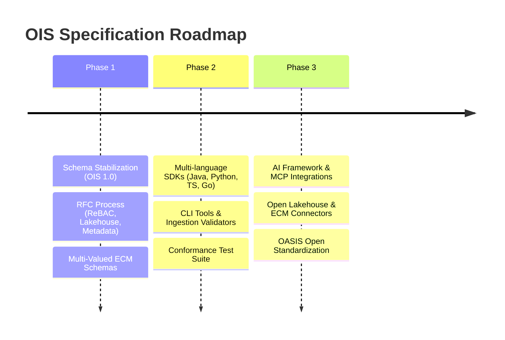

<!--
Copyright © 2026 the original author or authors (piergiorgio@apache.org)

Licensed under the Apache License, Version 2.0 (the "License");
you may not use this file except in compliance with the License.
You may obtain a copy of the License at

    http://www.apache.org/licenses/LICENSE-2.0

Unless required by applicable law or agreed to in writing, software
distributed under the License is distributed on an "AS IS" BASIS,
WITHOUT WARRANTIES OR CONDITIONS OF ANY KIND, either express or implied.
See the License for the specific language governing permissions and
limitations under the License.
-->

# Open Ingestion Standard (OIS) Roadmap 🗺️

This document outlines the strategic phases, releases, and milestones planned for the development and adoption of the **Open Ingestion Standard (OIS)**. 

Our ultimate goal is to establish a secure, vendor-neutral, and decoupled specification for enterprise data routing into modern vector databases, open analytical lakehouse table formats (Apache Iceberg, Delta Lake), cloud object stores, and AI architectures.

---

## 📅 Roadmap Overview

---

## 🛠️ Phase 1: Specification Stabilization & Schema 1.0.0 (Short-Term)
**Focus:** Finalize current schemas, validate core zero-trust security assumptions, support enterprise metadata models, and formalize the extension and RFC process.

- [x] **Release OIS 1.0.0-RC1 (Release Candidate)**
  - Finalize core validation constraints in [document.schema.json](schemas/document.schema.json) and [job.schema.json](schemas/job.schema.json), establishing standard extensions for CMIS repositories, BPMN 2.0 workflow engines (including real-time `bpmn:transitionEvent` notifications), pre-embedding governance (`ois:governance`), and delegated multi-agent provenance (`ois:provenance`).
  - Standardize the Claim Check lifecycle (`claimCheckUri`), cryptographic binary integrity (`sha256`), and the persistent `<key>.ois.json` Cloud/Lakehouse Sidecar format (`sidecarUri`).
  - Formalize normative `FAIL_CLOSED` security evaluation semantics and Relationship-Based Access Control (`relationships` / ReBAC) tuple mappings.
- [ ] **Multi-Valued Metadata & Lakehouse Schema Amendments**
  - Standardize multi-valued declared metadata properties (strings and `date-time` properties accepting either a single scalar or an array of values via `anyOf`) to faithfully represent real-world enterprise content management (ECM) metadata (e.g., CMIS multi-valued properties, multi-author documents) without lossy concatenation.
  - Formalize normative schema definitions for streaming tombstones and explicit document lifecycle deletion events (`sample-document-delete.json`).
  - Define mapping conventions from OIS document metadata and Zero-Trust access control lists into columnar Parquet/Iceberg schema definitions and table partition specs.
- [ ] **Initiate RFC (Request for Comments) Workflows**
  - Establish a formal RFC template and process for spec amendments.
  - Publish **RFC-001 (Security Identity & ReBAC Mapping)**: Discuss representation standards for Active Directory nested groups, OAuth 2.0 RFC 8693 delegated agent identities (`onBehalfOf` / `actorAgent`), and CNCF OpenFGA / Google Zanzibar relationship tuples.
  - Publish **RFC-002 (Open Lakehouse Table Format & Streaming Producer Semantics)**: Specify standardized streaming ingestion into Apache Iceberg and Delta Lake tables, including row-level Zero-Trust security columns, audit hash chains, and compaction lifecycle.
  - Publish **RFC-003 (Multi-Valued ECM Property Serialization & Streaming Push Boundaries)**: Standardize conventions for multi-valued arrays, nested schemas, and gRPC Push streaming boundaries.
- [ ] **Public Schema Registries & CI Automation**
  - Host versioned JSON schema files at static, accessible endpoints for automated IDE/CI integrations.
  - Set up automated schema testing using standard validator libraries in GitHub workflows, supporting cross-repository conformance suites (`ois-conformance`).

---

## ⚙️ Phase 2: Tooling, SDKs & Conformance Testing (Medium-Term)
**Focus:** Make it easy to adopt OIS across diverse ecosystems by providing ready-to-use client libraries, validation tools, and verifiable compliance suites.

- [ ] **CLI Validation & Inspection Tools**
  - Develop lightweight, cross-platform CLI validation tools (such as standalone `ois-validator` and runtime CLI integration via `oc schema validate`) to quickly validate streaming document payloads, `<key>.ois.json` sidecar files, and job configuration files against OIS schemas.
  - Support pre-crawl discovery and schema dry-run inspection in terminal environments.
- [ ] **Standard SDK Libraries**
  - **OIS Java Client SDK**: Maintain reference enterprise SDK (`oc-java-client-sdk`) for enterprise Java/Spring environments, providing typed builders for OIS document envelopes, JSON schema validation, gRPC streaming push clients, and Lakehouse sidecar parsers.
  - **OIS Python SDK**: Target AI/ML developers creating RAG and Agentic Ingestion pipelines with packages for payload validation, governance redaction envelopes, and metadata formatting.
  - **OIS TypeScript SDK**: Support Node.js/web-based backend, serverless functions, and Model Context Protocol (MCP) agent workflows.
  - **OIS Go SDK**: Target high-performance cloud-native microservices and edge migration connector agents.
- [ ] **Conformance Test Suite**
  - Establish a standard set of mock payloads, Fail-Closed ACL & ReBAC variations, `.ois.json` sidecar integrity checks, multi-valued property matrices, and Lakehouse Parquet projections.
  - Provide an automated test harness to certify that third-party repository crawlers, output connectors, and lakehouse consumers are strictly OIS-compliant.

---

## 🌐 Phase 3: Integration, Compatibility & Governance (Long-Term)
**Focus:** Drive wide-scale industry adoption, integrate with modern AI agentic protocols, and establish vendor-neutral standardization under OASIS Open.

- [ ] **AI Framework & Model Context Protocol (MCP) Integrations**
  - Build community-supported loaders and **Model Context Protocol (MCP)** tool contracts (e.g., `oc-mcp-server`) for AI orchestrators like **Spring AI**, **LlamaIndex**, **LangChain**, and **Haystack** to natively process OIS payloads, invoke pre-crawl discovery tools, and query `<key>.ois.json` lakehouse sidecars under Zero-Trust ACL filtering.
- [ ] **Open Lakehouse & Enterprise Cloud ECM Bridging**
  - Partner with open-source ingestion platforms (such as Apache ManifoldCF), distributed object stores (such as Apache Ozone), and open table engines (such as **Apache Iceberg** and **OLake**) to support zero-loss ECM-to-Lakehouse migrations and standardized OIS streaming ingestion pipelines.
  - Provide reference OIS bridging for enterprise Cloud ECM systems (Hyland Content Innovation Cloud, Microsoft SharePoint Online, Alfresco Cloud, OpenText Documentum, IBM FileNet).
- [ ] **OASIS Open Standardization**
  - Form the **OASIS Open Ingestion Standard (OIS) Technical Committee** with representatives from enterprise content management, cloud storage, lakehouse engine, connector vendors, and AI/vector database developers (see [OASIS-PROPOSAL.md](OASIS-PROPOSAL.md) and [OASIS-CHARTER.txt](OASIS-CHARTER.txt)).
  - Advance OIS to a ratified OASIS Standard, collaborating with the **OASIS CMIS**, **OASIS CoSAI** (Coalition for Secure AI), **OASIS Data Provenance**, and **OASIS XACML/ACAL** Technical Committees.

---

## 🤝 Contributing
We welcome help on all phases of this roadmap. If you are interested in working on schema refinements, SDKs, or integrations, please view our [MANIFESTO.md](MANIFESTO.md), participate in open issues, or start a new RFC discussion on GitHub!
