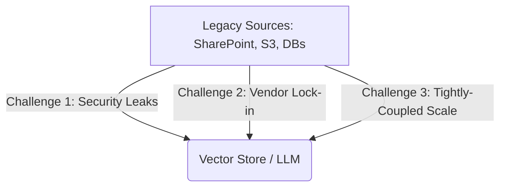
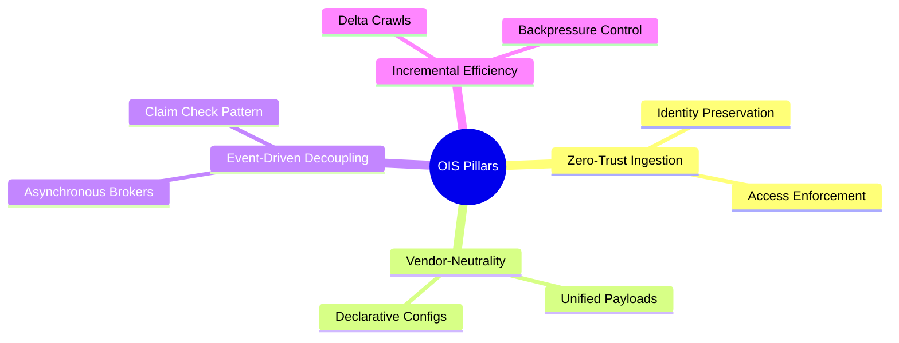

# Open Ingestion Standard (OIS) White Paper
*A secure, decoupled, and vendor-neutral specification for enterprise AI and RAG data ingestion.*

---

## Executive Summary
As enterprises increasingly adopt Retrieval-Augmented Generation (RAG), Multi-Agent AI, and Cloud Lakehouse architectures, the bottleneck has shifted from model capability to **governed data logistics**. Extracting structured and unstructured information from enterprise repository ecosystems—such as SharePoint, cloud storage buckets, databases, local file systems, CMIS repositories, cloud ECM platforms (e.g. Hyland Content Innovation Cloud, Alfresco), BPMN 2.0 workflow engines, and streaming push protocols—and routing it to vector databases, cloud object stores (such as Apache Ozone and AWS S3), or open lakehouse table formats (such as Apache Iceberg) remains a critical architectural challenge.

The **Open Ingestion Standard (OIS)** is a platform-agnostic specification, community manifesto, and schema standard designed to establish:
1. **Zero-Trust Fail-Closed Security & ReBAC Preservation:** Propagating legacy system Access Control Lists (ACLs) and Relationship-Based Access Control (ReBAC) tuples directly to vector indexes, lakehouse tables, and object stores under strict Fail-Closed semantics.
2. **In-Flight Pre-Embedding Governance:** Enforcing policy evaluation (`ALLOW`, `REDACT`, `DROP`) and PII redaction *before* irreversible vectorization or target storage occurs.
3. **Vendor-Neutral Data Exchange, Cloud Sidecars & Open Lakehouse Tables:** Standardizing how documents, cryptographic `SHA-256` checksums, metadata, and security payloads are formatted—as in-flight streaming envelopes, as persistent `<key>.ois.json` sidecar files in cloud object storage ("Migrate Now, AI Later"), and as structured records in open lakehouse tables (Apache Iceberg).
4. **Decoupled Event-Driven Scaling:** Leveraging asynchronous brokers and the Claim Check pattern to handle large-scale enterprise data streams.
5. **Declarative & Agent-Triggered Pipeline Management:** Providing a unified schema to define scheduled, event-driven, or autonomous agent-triggered (`AGENTIC`) crawlers, governance gates, transformers/narrativizers, splitters, embedders, and writers with delegated human provenance (`OAuth 2.0 RFC 8693`).

This white paper details the design requirements, architectural foundations, schemas, and reference implementations of OIS.

### Conformance & Terminology

The key words "MUST", "MUST NOT", "REQUIRED", "SHALL", "SHALL NOT", "SHOULD", "SHOULD NOT", "RECOMMENDED", "MAY", and "OPTIONAL" in this document are to be interpreted as described in RFC 2119.

---

## 1. The Enterprise Ingestion Crisis
Modern enterprise search and RAG platforms face three critical bottlenecks:



### Challenge 1: Security & Compliance Gaps (The ACL Leak)
Traditional search engines maintained strict document-level security. In modern AI architectures, files are processed, chunked, and embedded into vector databases. If the original security identifiers (Active Directory SIDs, OAuth groups, local roles) are discarded during chunking, the vector store becomes a security hazard. Any user querying the LLM can inadvertently retrieve chunks of proprietary files (e.g., payroll records, patent drafts) that they are not authorized to view.

### Challenge 2: Vendor Lock-in
Enterprise pipelines are typically built using vendor-specific ingestion tools. If an organization decides to transition from one vector database provider to another, or from a cloud embedding API to local models, they are forced to rewrite their entire ingestion code. There is no standard format to represent either the document payloads or the crawling job configurations.

### Challenge 3: Monolithic Scaling Constraints
Processing large binary documents (e.g., multi-hundred page PDF manuals) requires significant CPU resources for text extraction and GPU resources for vector embeddings. If these phases are tightly coupled inside a single process, the ingestion engine degrades. Large files block the pipeline, leading to backpressure and service outages.

---

## 2. Core Architectural Pillars
OIS is built on four core principles designed to resolve these challenges:



### Pillar 1: Zero-Trust Ingestion & Pre-Embedding Governance
Document security and compliance MUST be treated as first-class citizens:
* **Identity & Relationship Preservation:** Access Control Lists (ACLs) containing Windows SIDs, OAuth groups, CMIS principals, BPMN task roles, or ReBAC relationship tuples (`user`, `relation`, `object`) MUST be parsed at the source and mapped directly to the document `security` envelope.
* **Normative Fail-Closed Enforcement:** Compliant systems MUST enforce `FAIL_CLOSED` evaluation rules: a payload with an absent or empty `permissions` array MUST default to **Deny-All** (never public), explicit `deny` rules MUST take precedence over `read`/`write`, and effective access MUST be evaluated as the intersection ($\cap$) of repository, folder, and document permissions.
* **In-Flight Pre-Embedding Governance:** Because vector embeddings can invert or leak sensitive tokens, OIS pipelines SHOULD evaluate content at a pre-embedding governance gate (`ALLOW`, `REDACT`, `DROP`), redacting PII before chunking/embedding and recording an auditable `ois:governance` envelope.
* **Delegated Multi-Agent Identity (`RFC 8693`):** When an autonomous agent triggers discovery, ingestion, or migration on behalf of a human user, the pipeline MUST record both the human principal (`onBehalfOf` / `sub`) and the acting agent (`actorAgent` / `act.sub`) inside `ois:provenance`, bounding all operations to the human user's source permissions.

### Pillar 2: Vendor-Neutral Interoperability & Cloud Object Migration
By decoupling the source connector from the target vector or object writer, OIS ensures absolute flexibility:
* **Standard Exchange & Persistent Sidecar Formats (`<key>.ois.json`):** All extracted data MUST be encapsulated in a schema-compliant JSON structure. When migrating legacy ECM repositories to cloud/lakehouse object storage (such as Apache Ozone or AWS S3), each raw binary object `<key>` is accompanied by a persistent `<key>.ois.json` sidecar file containing normalized metadata, source ACLs, and a `sha256` checksum ("Migrate Now, AI Later").
* **Declarative & Agentic Pipeline Configuration:** Scheduled cron jobs, event-driven webhooks, and agent-triggered (`AGENTIC` / `ON_DEMAND`) jobs—including dry-run discovery, scoped folder overrides, and optional four-eyes approval (`requiresApproval`)—MUST be configured using standard, platform-agnostic JSON/YAML descriptors.

### Pillar 3: Event-Driven Decoupling
To achieve horizontal scaling, OIS pipelines MUST isolate tasks:
* **Asynchronous Message Broker:** Document ingestion MUST be broken down into discrete steps (Scan $\to$ Extract $\to$ Govern/Redact $\to$ Transform $\to$ Chunk $\to$ Embed/Persist) managed by an event broker (e.g., Apache Kafka).
* **Claim Check & Cryptographic Integrity:** Standard queue messages MUST be lightweight. Large binary files are stored in shared object storage, and the queue message carries a URI reference (`claimCheckUri` / `sidecarUri`) and a hex-encoded `sha256` digest to prevent broker saturation and guarantee zero-loss binary fidelity.

### Pillar 4: Incremental & Real-Time Efficiency
To protect enterprise source systems from resource exhaustion:
* **Stateful Delta Crawls, Real-Time Workflow Transitions & Tombstoning:** Connectors MUST track incremental cursors or subscribe to real-time BPMN 2.0 transition events (`bpmn:transitionEvent`), publishing document updates (`action: "UPSERT"`) or immediate deletion/revocation tombstones (`action: "DELETE"`).
* **Dynamic Backpressure:** Subsystems MUST adjust consumption rates to match downstream indexing and embedding throughput.

---

## 3. OIS Schema Specifications

OIS formalizes two primary JSON schemas:

### A. Document Payload Schema
The `document.schema.json` dictates how document text, metadata, lifecycle action (`UPSERT` / `DELETE`), and security settings are wrapped for transport.

```json
{
  "$schema": "http://json-schema.org/draft-07/schema#",
  "$id": "https://opencrawling.org/schemas/ois-document-schema.json",
  "title": "OIS Document Payload Schema",
  "type": "object",
  "required": ["id", "source"],
  "properties": {
    "id": { "type": "string" },
    "action": {
      "type": "string",
      "enum": ["UPSERT", "DELETE"],
      "default": "UPSERT"
    },
    "source": {
      "type": "object",
      "required": ["type", "instance"],
      "properties": {
        "type": { "type": "string" },
        "instance": { "type": "string", "format": "uri-reference" }
      }
    },
    "content": {
      "type": "object",
      "required": ["mimeType"],
      "properties": {
        "mimeType": { "type": "string" },
        "text": { "type": "string" },
        "claimCheckUri": { "type": "string", "format": "uri-reference" }
      }
    },
    "metadata": { "type": "object", "additionalProperties": true },
    "security": {
      "type": "object",
      "required": ["inheritanceEnabled", "permissions"],
      "properties": {
        "inheritanceEnabled": { "type": "boolean" },
        "permissions": {
          "type": "array",
          "items": {
            "type": "object",
            "required": ["identity", "identityType", "access"],
            "properties": {
              "identity": { "type": "string" },
              "identityType": { "type": "string" },
              "access": { "type": "string", "enum": ["read", "write", "deny"] }
            }
          }
        }
      }
    }
  }
}
```

### B. Job Configuration Schema
The `job.schema.json` defines declarative templates to schedule and orchestrate ingestion runs.

```json
{
  "$schema": "http://json-schema.org/draft-07/schema#",
  "$id": "https://opencrawling.org/schemas/ois-job-schema.json",
  "title": "OIS Ingestion Job Configuration Schema",
  "type": "object",
  "required": ["version", "metadata", "spec"],
  "properties": {
    "version": { "type": "string" },
    "metadata": {
      "type": "object",
      "required": ["name"],
      "properties": {
        "name": { "type": "string" }
      }
    },
    "spec": {
      "type": "object",
      "required": ["schedule", "connector", "output"],
      "properties": {
        "schedule": { "type": "string" },
        "connector": {
          "type": "object",
          "required": ["type", "config"]
        },
        "pipeline": {
          "type": "object",
          "properties": {
            "textExtraction": {
              "type": "object",
              "properties": {
                "tikaEnabled": { "type": "boolean" },
                "ocrEnabled": { "type": "boolean" }
              }
            },
            "transformation": {
              "type": "object",
              "properties": {
                "strategy": { "type": "string", "enum": ["mustache", "json-to-text", "none"] },
                "template": { "type": "string" }
              }
            },
            "chunking": {
              "type": "object",
              "properties": {
                "strategy": { "type": "string", "enum": ["token-split", "sentence-split", "page-split"] },
                "maxTokens": { "type": "integer" },
                "overlap": { "type": "integer" }
              }
            },
            "embedding": {
              "type": "object",
              "required": ["model", "provider"],
              "properties": {
                "model": { "type": "string" },
                "provider": { "type": "string" },
                "endpoint": { "type": "string", "format": "uri-reference" }
              }
            }
          }
        },
        "output": {
          "type": "object",
          "required": ["type", "config"]
        }
      }
    }
  }
}
```

### C. CMIS and BPMN 2.0 Extensions

To support legacy Enterprise Content Management (ECM) and Business Process Management (BPM) ecosystems, OIS defines standard mappings for:

#### 1. Content Management Interoperability Services (CMIS)
Enterprise repositories complying with the CMIS standard expose hierarchical objects (documents, folders) and detailed metadata. OIS represents CMIS objects by mapping:
* **Source Type**: Set `source.type` to `cmis`.
* **Metadata Envelope**: CMIS-specific properties are prefixed with `cmis:` (e.g., `cmis:objectId`, `cmis:objectTypeId`, `cmis:versionLabel`, `cmis:creationDate`, `cmis:createdBy`).
* **Security Model**: CMIS Access Control Entries (ACEs) map directly to OIS `security.permissions`, setting the identity types to `cmis-user` or `cmis-group`.

#### 2. BPMN 2.0 Business Processes & Workflow Instances
To index the dynamic execution state of process instances from engines like Camunda, Flowable, or jBPM, OIS represents workflow instances as queryable documents:
* **Source Type**: Set `source.type` to `bpmn2`.
* **Metadata Envelope**: Ingests process definition, variables, and history under `bpmn:` prefix (e.g., `bpmn:processInstanceId`, `bpmn:processDefinitionKey`, `bpmn:status`, `bpmn:variables`, `bpmn:activeTasks`).
* **Active Tasks Mapping**: The active activities, assignees, and candidate groups are indexed inside `bpmn:activeTasks` to support real-time context mapping.
* **Real-Time Transition Events (`bpmn:transitionEvent`)**: When a workflow transitions state (`TASK_ASSIGNED`, `TASK_COMPLETED`, `ACL_UPDATED`, `PROCESS_COMPLETED`, `PROCESS_TERMINATED`), the engine emits an event-driven OIS `UPSERT` or `DELETE` tombstone to mutate or revoke downstream permissions immediately.
* **Security Model**: Security restrictions map dynamically based on runtime participation roles. The `security.permissions` array registers identities with types like `bpmn-assignee`, `bpmn-candidate-user`, `bpmn-candidate-group`, or `bpmn-supervisor` to restrict query visibility to users involved in the active task or process hierarchy.

#### 3. Cloud & Lakehouse Migration Sidecars (`<key>.ois.json`) and Agentic Discovery
When organizations decommission legacy ECM systems or consolidate content into distributed object stores (such as Apache Ozone or AWS S3), raw object storage natively lacks hierarchical CMIS metadata and source ACL semantics. OIS bridges this gap via the **Persistent Sidecar Convention**:
* **Companion `<key>.ois.json` Envelope**: Alongside each migrated binary object `<key>`, the writer persists `<key>.ois.json` conforming to `document.schema.json`, recording `content.sha256`, `content.sizeBytes`, `content.sidecarUri`, normalized `metadata`, and `security`.
* **Agentic Migration & Sidecar Retrieval**: Autonomous AI agents can discover, filter, and inspect `.ois.json` sidecar envelopes under Zero-Trust ACL enforcement (`FAIL_CLOSED`) without downloading bulky raw binaries or re-crawling legacy sources.
* **Delegated Provenance & Governance Audit**: Agent-triggered jobs (`trigger.mode: "AGENTIC"`) capture delegated human identity (`ois:provenance.onBehalfOf` and `actorAgent` per OAuth 2.0 RFC 8693) and pre-embedding PII redaction outcomes (`ois:governance`).

#### 4. Open Lakehouse Table Architectures (Apache Iceberg)
In addition to object sidecars, OIS maps structured document records, lineage, and Zero-Trust access control lists into open columnar lakehouse table formats managed by **Apache Iceberg** (and Apache Parquet):
* **ACID Transactions & Snapshot Isolation**: Guarantees serializable commits for batch and streaming ingestion pipelines with built-in time-travel and partition pruning capabilities.
* **Preserved Access Control Columns**: Ingested records carry explicit Zero-Trust permission columns (`allowed_principals`, `denied_principals`, `security_owner`) enabling downstream analytical engines (such as DuckDB, Trino, and Apache Spark) to enforce row-level access control without data duplication.
* **Dynamic Schema Evolution**: Allows enterprise metadata and extracted document entities to dynamically evolve lakehouse schemas across ingestion runs.

---

## 4. Reference Implementation: OpenCrawling
The open-source **OpenCrawling** platform serves as the reference implementation for OIS. It showcases how a decoupled, Java 25 runtime can scale ingestion using Kafka, Apache Tika 4 text extraction, in-flight Pre-Embedding Governance Gates, Spring AI embeddings, and multi-target persistence across vector databases (PostgreSQL/pgvector, Milvus, Qdrant, Vespa, Solr, OpenSearch), cloud migration sidecars (Apache Ozone, AWS S3), and open lakehouse tables (Apache Iceberg).

```
                  +--------------------------------+
                  |  OpenCrawling Repository Scan  |
                  +---------------+----------------+
                                  |
                                  v  (IngestionMessage)
                  +---------------+----------------+
                  |      Kafka Ingestion Topic     |
                  +---------------+----------------+
                                  |
                                  v  (Tika / Tokenizer)
                  +---------------+----------------+
                  |     Kafka Document Chunks      |
                  +---------------+----------------+
                                  |
                                  v  (Ollama Embeddings Router)
           +----------------------+----------------------+
           |                      |                      |
           v (384-dim)            v (768-dim)            v (1024-dim)
    [vector_store_384]     [vector_store_768]     [vector_store_1024]
```

### Flexible Routing & Dimension Mapping
OpenCrawling utilizes OIS's job configuration to deploy different embedding models dynamically. It resolves model names to vector store tables optimized for specific dimensional requirements:
* **all-minilm** (384-dim): Maps payloads to the database table `vector_store_384`.
* **nomic-embed-text** (768-dim): Maps payloads to `vector_store_768`.
* **mxbai-embed-large** (1024-dim, default): Maps payloads to `vector_store_1024`.

By decoupling the embedding consumer from the database writer, OpenCrawling achieves sub-millisecond table routing without requiring recompilation of the pipeline.

---

## 5. Roadmap & Open Governance
The OIS Initiative is designed for long-term community stewardship. The project roadmap is split into three phases:

1. **Phase 1: Schema Stabilization (Current)**
   * Finalize the OIS 1.0 specifications (`document.schema.json` and `job.schema.json`), including `.ois.json` sidecar conventions, `FAIL_CLOSED` security semantics, ReBAC tuples, pre-embedding governance, and agentic job triggers.
   * Implement automated CI schema validation across all reference examples.
2. **Phase 2: Client SDKs & Conformance Tools**
   * Release official Python, Go, and TypeScript SDKs to help developers write compliant source connectors, governance gates, and output writers.
   * Publish CLI validation binaries and conformance test suites.
3. **Phase 3: OASIS Open Standardization**
   * Transition the standard to the **OASIS Open Ingestion Standard (OIS) Technical Committee** (see [OASIS-PROPOSAL.md](OASIS-PROPOSAL.md)) to guarantee long-term vendor neutrality and formal alignment with OASIS CMIS, CoSAI, Data Provenance, and XACML/ACAL.

---

## Conclusion
The **Open Ingestion Standard** bridges the security and scalability gaps in enterprise RAG pipelines. By standardizing document payloads, preserving source-level security credentials, and enabling declarative configurations, OIS provides a blueprint for robust, future-proof AI data logistics.

For detailed schema files, manifestos, and examples, visit the standard repository: [open-ingestion-standard](file:///Users/piergiorgiolucidi/Documents/workspaces/opencrawling/open-ingestion-standard).
